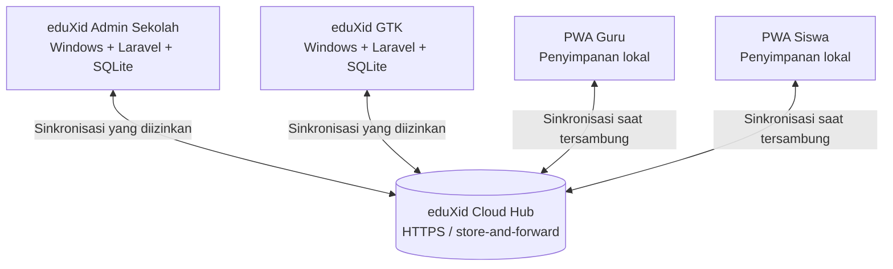

<div align="center">

# eduXid

### Platform Manajemen Sekolah Pintar

**Aplikasi manajemen sekolah dan pembelajaran berbasis Windows, gratis, portable, dan offline-first.**

**Admin Sekolah · Guru & Tenaga Kependidikan · PWA Guru · PWA Siswa**

[Repository](https://github.com/afanasfarhan/eduXid) · [Laporkan Masalah](https://github.com/afanasfarhan/eduXid/issues) · [Kontak Pengembang](mailto:af.anasfarhan@gmail.com)

</div>

---

## Tentang eduXid

**eduXid** adalah platform manajemen sekolah yang dikembangkan untuk membantu pekerjaan administrasi, pembelajaran, asesmen, dan pelaporan sekolah dalam satu ekosistem. Aplikasi Windows berjalan menggunakan **server Laravel lokal pada komputer/laptop**, sehingga pekerjaan utama tetap dapat dilakukan saat tidak terhubung ke internet.

Untuk pertukaran data antarperangkat, eduXid menggunakan **Cloud Hub** melalui HTTPS dengan pola *store-and-forward*. Cloud membantu mengantarkan data dan pembaruan; **database utama tetap berada pada instalasi lokal**, bukan dipindahkan seluruhnya ke Cloud.

Dirancang untuk kebutuhan sekolah dari **SD hingga SMA**, dengan akses dan fitur yang disesuaikan menurut peran masing-masing pengguna.

> **Gratis digunakan.** Fitur inti eduXid tidak dikunci oleh pembayaran. Dukungan/donasi bersifat sukarela dan tidak sama dengan persyaratan penggunaan aplikasi.

## Fitur utama

| Bidang | Kemampuan |
|---|---|
| **Data pokok sekolah** | Pengelolaan sekolah, GTK, peserta didik, kelas/rombel, mata pelajaran, dan penugasan mengajar; sinkronisasi API Dapodik atau impor Excel. |
| **Administrasi guru** | ATP, tujuan pembelajaran, materi, penugasan, jurnal/administrasi mengajar, dan dokumen pembelajaran sesuai modul yang tersedia. |
| **Bank Soal** | Pengelolaan soal, impor/ekspor Excel, soal bergambar, pemilihan dan pencetakan soal. |
| **Ujian** | Manajemen ujian, CBT, lembar jawaban komputer (LJK), kunci jawaban, koreksi, dan analisis butir soal. |
| **Koreksi LJK** | Pemindaian menggunakan kamera HP atau berkas hasil scanner pada alur yang didukung, dengan hasil yang dapat diteruskan ke Buku Nilai. |
| **LMS** | Kelas/course, topik, materi, tugas, pengumpulan pekerjaan, dan aktivitas belajar siswa. |
| **Penilaian** | Buku Nilai, nilai akhir, deskripsi capaian, dan pelaporan pembelajaran. |
| **Rapor** | Integrasi penilaian dengan delapan dimensi profil lulusan. |
| **Tata usaha** | Profil sekolah, surat dinas, arsip surat, kartu pelajar, dan administrasi ujian. |
| **Wali kelas & BK** | Akses tugas tambahan berdasarkan penugasan dan kewenangan pengguna. |
| **PWA Guru & Siswa** | Akses melalui perangkat seluler dengan penyimpanan lokal/offline-first dan sinkronisasi ketika terhubung. |
| **Cloud & pembaruan** | Pairing perangkat, pertukaran data melalui Cloud Hub, serta pembaruan bertanda tangan pada instalasi yang kompatibel. |

*Ketersediaan detail fitur dapat berbeda menurut edisi, konfigurasi sekolah, dan versi paket yang dipasang.*

### Delapan dimensi profil lulusan

1. Keimanan dan Ketakwaan terhadap Tuhan Yang Maha Esa
2. Kewargaan
3. Penalaran Kritis
4. Kreativitas
5. Kolaborasi
6. Kemandirian
7. Kesehatan
8. Komunikasi

## Ekosistem dan arsitektur



**Prinsip desain:**

- **Offline-first:** komputer/laptop menjalankan layanan eduXid secara lokal; fitur yang tidak memerlukan Cloud tetap dapat digunakan saat offline.
- **Multi-perangkat:** Admin, laptop GTK, PWA Guru, dan PWA Siswa dapat saling bertukar data sesuai hak akses dan status sinkronisasi.
- **Identitas terikat sekolah:** perangkat menggunakan identitas sekolah dan pengguna serta proses pairing yang sah.
- **Kepemilikan data lokal:** Cloud Hub adalah jalur pengantaran, bukan pengganti database masing-masing instalasi.
- **Keamanan rilis:** mekanisme updater pada paket yang kompatibel memvalidasi integritas dan tanda tangan Ed25519 sebelum pemasangan.

> **Perlu internet untuk:** pairing/aktivasi Cloud tertentu, sinkronisasi antarperangkat melalui Cloud, dan pengunduhan pembaruan Cloud. **Integrasi Dapodik** memerlukan akses ke layanan Dapodik sesuai konfigurasi sekolah.

## Memulai penggunaan

### 1. Admin Sekolah (Windows)

Gunakan **paket distribusi Admin lengkap** dari penerbit eduXid. Repository kode sumber tidak selalu merupakan paket Windows siap jalan.

1. Ekstrak paket distribusi ke folder yang memiliki izin baca/tulis (misalnya `D:\eduXid-ADMIN`).
2. Jalankan **`eduXid.exe`** dari root folder distribusi.
3. Buka antarmuka eduXid pada browser yang diluncurkan aplikasi.
4. Selesaikan inisialisasi sekolah dan **amankan kata sandi Admin** sebelum penggunaan jaringan.
5. Isi data pokok melalui **sinkronisasi Dapodik** atau **impor Excel**.
6. Periksa NPSN, data GTK, siswa, rombel, mata pelajaran, dan penugasan mengajar.
7. Lakukan aktivasi/pairing Cloud melalui mekanisme resmi jika akan memakai sinkronisasi perangkat.
8. Buat dan bagikan paket GTK untuk masing-masing guru melalui menu yang tersedia.

**Jangan menyalin file `.env`, database, identitas perangkat, atau token pairing dari instalasi sekolah lain.**

### 2. Guru dan Tenaga Kependidikan (GTK)

1. Terima **paket GTK untuk akun yang bersangkutan** dari Admin Sekolah.
2. Ekstrak pada laptop guru dan jalankan `eduXid.exe`.
3. Masuk menggunakan akun yang diberikan Admin; ganti kata sandi awal bila diperlukan.
4. Selesaikan pairing perangkat apabila diminta.
5. Sinkronkan data pokok dan periksa penugasan kelas/mapel sebelum menggunakan fitur inti.

Paket GTK ditujukan untuk pemilik akun yang sesuai, **bukan untuk digandakan ke guru lain dengan identitas perangkat yang sama**.

### 3. PWA Guru dan PWA Siswa

Gunakan alamat/tautan PWA serta prosedur pairing atau bergabung yang disediakan sekolah. Data tertentu dapat dibaca atau dikerjakan secara offline dan disinkronkan saat koneksi tersedia. Hindari menghapus data browser/PWA sebelum status sinkronisasi pekerjaan penting dipastikan selesai.

## Struktur paket distribusi Windows

Paket lengkap umumnya berbentuk:

```text
eduXid-ADMIN/  atau  eduXid-GTK/
├── eduXid.exe                  # Launcher Windows
├── PETUNJUK PENGGUNAAN.txt
├── eduXid/                     # Aplikasi Laravel
├── php/                        # PHP portable
└── system/                     # Komponen launcher/updater
    └── update/                 # Helper internal pembaruan
```

Folder ini menggambarkan **paket distribusi**, bukan persyaratan struktur setiap checkout GitHub. Untuk pengembangan source Laravel, lihat `eduXid/composer.json` (memerlukan PHP **8.3 atau lebih baru** sesuai dependensi proyek).

## Backup, pemulihan, dan pembaruan

- **Lakukan backup** sebelum pembaruan besar, pemindahan laptop, migrasi data, atau restore.
- Backup pekerjaan guru dalam format **JSON** dan cadangan database **SQLite** memiliki cakupan berbeda; tidak semua berkas media/PWA otomatis termasuk di dalamnya.
- Pemulihan backup lintas versi harus melalui **pemeriksaan integritas, kecocokan identitas, dan kompatibilitas skema**. Uji restore pada salinan terpisah sebelum mengganti data aktif.
- Pada instalasi yang kompatibel, pembaruan diperiksa ketika **launcher dijalankan**, lalu diverifikasi dengan SHA-256/Ed25519, backup, pemeriksaan keamanan, pemasangan, dan rollback jika gagal.
- **GTK generasi lama tertentu** masih membutuhkan pemeriksaan kompatibilitas bootstrap updater sebelum dapat menerima seluruh pembaruan otomatis melalui Cloud.

Jangan mengganti nomor versi, file database, `.env`, maupun isi `system/update` secara manual untuk memaksa pembaruan berhasil.

## Keamanan dan privasi

Repository publik **tidak boleh** memuat:

- File `.env` aktif dan file konfigurasi dengan token atau kredensial yang terisi.
- `EDUXID_UPDATE_PRIVATE_KEY`, private key lainnya, token pairing, atau data pemulihan identitas.
- Database sekolah aktif (`eduXid/eduxid`, `.sqlite`, `.db`) beserta file SQLite sidecar.
- Backup guru/sekolah yang memuat data pribadi, log sensitif, atau kunci identitas.

Gunakan konfigurasi contoh yang telah disanitasi, tinjau perubahan sebelum `git push`, dan lakukan **rotasi kredensial** bila pernah terunggah ke repository publik. *Public key* untuk verifikasi rilis dapat didistribusikan; *private key* penandatanganan harus disimpan hanya oleh penerbit.

## Pertanyaan umum

**Apakah eduXid membutuhkan internet sepanjang waktu?**  
Tidak. Pekerjaan lokal dapat berlangsung secara offline. Cloud diperlukan untuk fungsi sinkronisasi, pairing tertentu, dan mengunduh pembaruan.

**Apakah eduXid berbayar?**  
Tidak. eduXid ditujukan sebagai platform gratis; donasi pengembangan bersifat sukarela.

**Apakah semua laptop guru memakai satu database pusat?**  
Tidak. Tiap instalasi memiliki data lokal yang disinkronkan sesuai aturan kepemilikan dan hak akses.

**Apakah source GitHub dapat langsung dijalankan dengan mengklik `eduXid.exe`?**  
Hanya jika checkout/paket tersebut sudah memuat launcher, PHP portable, dependensi, dan konfigurasi distribusi yang diperlukan. Untuk pengguna sekolah, gunakan paket distribusi lengkap resmi.

**Apakah backup GTK lama bisa dipulihkan di GTK baru?**  
Kompatibilitas backup–restore merupakan sasaran penting eduXid, tetapi keberhasilannya bergantung pada jenis backup, identitas, dan skema database. Selalu verifikasi pada salinan instalasi sebelum memulihkan data aktif.

## Pengembangan dan kontribusi

Pengembangan eduXid mencakup pematangan updater lintas versi, penyempurnaan pembelajaran dan asesmen, serta peningkatan pengalaman offline-first. Beberapa fitur atau rancangan baru mungkin masih dalam tahap pengujian dan **belum tersedia pada setiap rilis**.

Untuk pertanyaan teknis, saran, dan laporan masalah, gunakan [GitHub Issues](https://github.com/afanasfarhan/eduXid/issues) atau hubungi pengembang. Saat melaporkan masalah, **hapus token, kata sandi, NISN/NIP, database dan informasi pribadi** dari tangkapan layar serta log.

## Lisensi dan penggunaan

**eduXid gratis digunakan**, tetapi status gratis **tidak otomatis berarti seluruh source berlisensi open source**. Ketentuan penyalinan, modifikasi, dan distribusi source mengikuti izin/lisensi yang secara terpisah ditetapkan oleh pemilik proyek. Lisensi dependensi seperti Laravel tetap berlaku untuk dependensi tersebut; lisensi Laravel tidak otomatis mencakup seluruh kode eduXid.

## Pengembang

**Anas Farhan**  
Email: [af.anasfarhan@gmail.com](mailto:af.anasfarhan@gmail.com)  
GitHub: [@afanasfarhan](https://github.com/afanasfarhan)

---

<div align="center">

**eduXid — Platform Manajemen Sekolah Pintar**  
*Dikembangkan untuk memudahkan pekerjaan sekolah, guru, dan peserta didik.*

</div>
